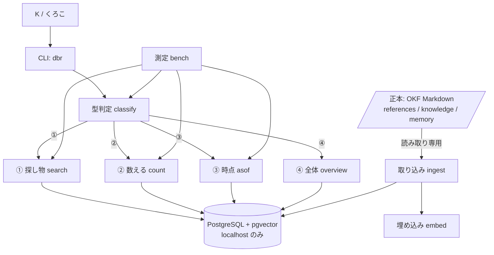
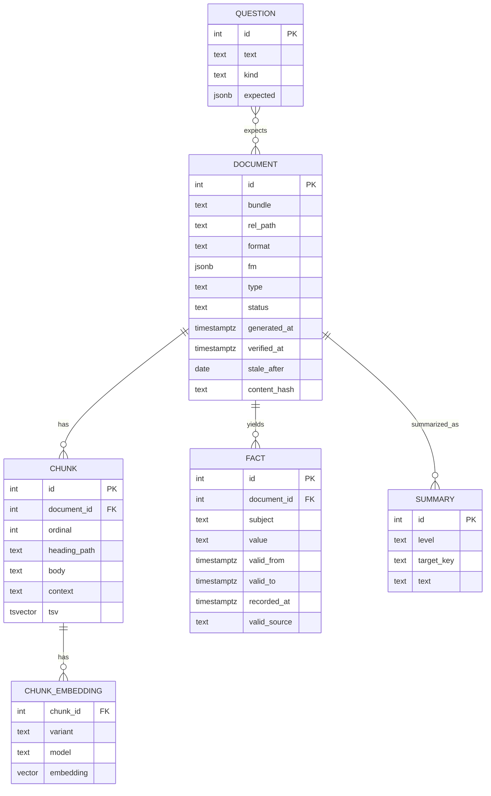
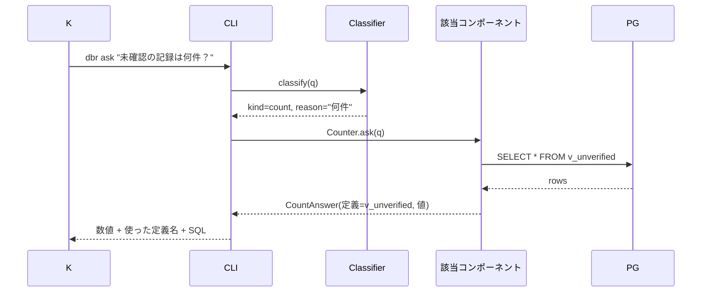
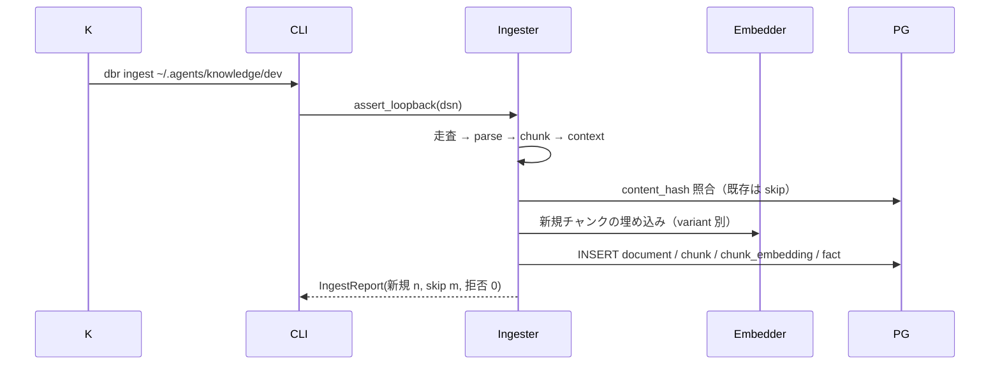

# 機能設計書 (Functional Design Document)

> 入力: [product-requirements.md](product-requirements.md)（K承認済み・D-1〜D-12）。コード例は Python 3.12 と SQL で書く。

## システム構成図



- 正本（Markdown）への矢印は**一方向**。本基盤は Markdown を書き換えない。
- `PG` はループバック接続のみ。`ingest` は接続先がループバック以外なら起動時に拒否する。

## 技術スタック

| 分類 | 技術 | 選定理由 |
|------|------|----------|
| 言語 | Python 3.12 / uv / ruff / mypy strict / pytest | テンプレ標準（D-2）。研究用スクリプトと CLI を同じ言語で |
| DB | PostgreSQL 16 系（Docker）＋ pgvector | 4型すべてを1つの DB で受ける（D-2/D-7）。Supabase 対応版と同じメジャーを選ぶ（機能差が無い範囲で D-4） |
| 全文検索 | PostgreSQL 標準 `tsvector` ＋ 日本語トークナイズ | 方式は architecture で確定（未決）。候補: `pg_bigm`（Supabase 対応）／アプリ側で分かち書きして `simple` 辞書 |
| 埋め込み | 抽象 `Embedder` インターフェース。実装は外部 API とローカルモデルの2種 | `references/` 本文を外部へ送るかは未決。差し替え可能にして研究を止めない |
| DB アクセス | psycopg 3 ＋ 素の SQL（ORM 不使用） | SQL そのものが研究対象。ビュー・範囲型・インデックスを隠さない |
| マイグレーション | SQL ファイル＋番号順適用（自作の薄い runner） | D-3。Supabase にもそのまま流せる形 |
| CLI | `typer` | サブコマンドと型付き引数が最小コストで書ける |

## データモデル定義

### エンティティ: Document（1 Markdown ファイル）

```python
@dataclass(frozen=True)
class Document:
    id: int
    bundle: str            # references / dev / stock / tax / scout / memory / experiments
    rel_path: str          # バンドル起点の相対パス（一意キー: bundle + rel_path）
    format: str            # 'okf' | 'kuroko'  ← D-12 の比較用。どの形式で解釈したか
    fm: dict               # フロントマター全体（jsonb）
    type: str | None       # fm.type（memory は fm.metadata.type）
    status: str            # draft | stable | deprecated（省略時 stable）
    generated_at: datetime | None
    verified_at: datetime | None   # verified がリストなら最大の at
    stale_after: date | None
    content_hash: str      # 本文+fm の SHA-256。冪等取り込みの判定キー
    ingested_at: datetime
```

**制約**:
- `(bundle, rel_path)` 一意。再取り込みで `content_hash` が同じ行は**更新しない**（冪等）
- `rel_path` が `private.md` に一致する行は挿入禁止（トリガーで拒否）
- 日付だけの `generated.at` は `00:00:00+09:00` を補って保存し、`fm` 側に原文を残す

### エンティティ: Chunk（見出し単位の断片）

```python
@dataclass(frozen=True)
class Chunk:
    id: int
    document_id: int
    ordinal: int           # 文書内の順番
    heading_path: str      # "H1 > H2 > H3"
    body: str              # 断片本文
    context: str | None    # 文脈文（「このファイルは◯◯の△△節」）。文脈付与あり/なしの比較用
    tokens: int
    tsv: TSVector          # 全文検索用（生成列）
    embedding: Vector | None   # 次元は Embedder に依存。embedding_model 列で区別
    embedding_model: str | None
```

**制約**:
- `(document_id, ordinal)` 一意
- 埋め込みは `context + body` に対して生成する（文脈付与あり）／`body` のみ（なし）を **別行でなく別列** で持たない。方式比較は `embedding_model` に `':ctx'` 接尾辞を付けた**別レコード集合**として持つ（同一チャンクに複数埋め込み → `chunk_embedding` 子テーブルへ分離）

### エンティティ: ChunkEmbedding（方式別の埋め込み）

```python
@dataclass(frozen=True)
class ChunkEmbedding:
    chunk_id: int
    variant: str           # 'plain' | 'ctx'
    model: str
    embedding: Vector
```

### エンティティ: Fact（③ 時点用・バイテンポラル）

```python
@dataclass(frozen=True)
class Fact:
    id: int
    document_id: int
    subject: str           # 何についての事実か（例: "評価係の起動条件"）
    value: str             # 事実の内容
    valid_from: datetime
    valid_to: datetime | None      # None = 現在も有効
    recorded_at: datetime          # 記録時間（generated.at 由来）
    valid_source: str      # 'explicit'（fm.valid あり）| 'inferred'（generated.at を暫定使用）
```

**制約**:
- 同じ `subject` で `valid_to IS NULL` の行は**高々1つ**（部分一意インデックス）
- 更新は「旧行の `valid_to` を閉じて新行を挿入」。削除しない
- `valid_source = 'inferred'` の行は、③の回答で「暫定」と明示する

### エンティティ: Summary（④ 全体用・要約階層）

```python
@dataclass(frozen=True)
class Summary:
    id: int
    level: str             # 'bundle' | 'document' | 'section'
    target_key: str        # bundle 名 / document_id / chunk_id
    text: str
    source_hash: str       # 元テキストのハッシュ（陳腐化検知）
    model: str
    tokens_in: int
    tokens_out: int
```

### エンティティ: Question（測定用）

```python
@dataclass(frozen=True)
class Question:
    id: int
    text: str
    kind: str              # 'find' | 'count' | 'asof' | 'overview'   ← K が付けた正解ラベル
    expected: dict         # find: 正解 rel_path 群 / count: 数値 / asof: 事実 / overview: 採点対象
```

### ER図



## コンポーネント設計

### Ingest（F1）

**責務**:
- フォルダ走査 → フロントマター解析（素の OKF／くろこ拡張の両対応）→ チャンク分割 → 文脈文生成 → 埋め込み → 挿入
- 冪等性（`content_hash` 一致なら skip）と `private.md` 除外
- 接続先のループバック検査

**インターフェース**:
```python
class Ingester:
    def __init__(self, conn: Connection, embedder: Embedder, *, variants: set[str]) -> None: ...
    def run(self, root: Path, bundle: str) -> IngestReport: ...   # 件数・skip・エラーを返す

class FrontmatterParser:
    def parse(self, text: str) -> ParsedDoc: ...   # format を 'okf' | 'kuroko' で判定して返す

class Chunker:
    def split(self, markdown: str, *, max_tokens: int = 800) -> list[RawChunk]: ...

def assert_loopback(dsn: str) -> None: ...   # host が localhost/127.0.0.1/::1 以外なら例外
```

**依存関係**: `Embedder`、`psycopg`、`FrontmatterParser`、`Chunker`

**形式判定の規則（D-12）**:
| 観測 | format |
|---|---|
| `metadata:` 配下に `type` がある | `kuroko`（memory 拡張） |
| `description` があり `type` が閉じた語彙に一致 | `kuroko` |
| 上記以外で `type` がある | `okf` |
| `type` が無い | 取り込むが `type=None`・WARN |

### Classifier（F2）

**責務**: 質問文 → `find | count | asof | overview | unknown` ＋ 理由

**インターフェース**:
```python
class Classifier(Protocol):
    def classify(self, question: str) -> Classification: ...   # kind, reason, confidence

class RuleClassifier(Classifier): ...      # 語彙ルール（何件・いくつ・合計 → count / 時点・いつ・当時 → asof / 全体・傾向 → overview）
class LLMClassifier(Classifier): ...       # 4型の定義と例を渡して1語で返させる（外部 API 利用時のみ）
```

**設計上の決め**: 判定不能は `unknown` を返し、**`find` に倒さない**（PRD F2）。CLI は `unknown` のとき候補2つを提示して止まる。

### Search（F3・① 探し物）

**責務**: 方式を切り替えて上位N件を返す

**インターフェース**:
```python
Mode = Literal["embed", "fts", "hybrid", "hybrid_ctx", "hybrid_ctx_rerank"]

class Searcher:
    def search(self, q: str, *, mode: Mode, k: int = 20) -> list[Hit]: ...
    # Hit: rel_path, heading_path, body, score, source ('embed'|'fts'|'both')
```

**アルゴリズム設計（ハイブリッド統合）**:
- 埋め込み検索: `ORDER BY embedding <=> :q LIMIT 100`（cosine）
- 全文検索: `ts_rank_cd(tsv, query) LIMIT 100`
- 統合: **RRF（Reciprocal Rank Fusion）** `score = Σ 1/(60 + rank_i)`。スコアの尺度が違う2系を混ぜるのに正規化が要らない
- `hybrid_ctx`: 埋め込み側を `variant='ctx'` の子テーブルで検索
- `hybrid_ctx_rerank`: 上位150件を並べ直し器（外部 API または cross-encoder）に通して上位20件

### Counter（F4・② 数える）

**責務**: 名前付きビューを呼ぶだけ。**LLM に SQL を書かせない**（PRD F4 の「3回とも同じ数字」）

**ビュー（マイグレーションで定義）**:
| ビュー | 定義 |
|---|---|
| `v_unverified` | `verified_at IS NULL AND status <> 'deprecated'` の件数（bundle 別） |
| `v_by_type` | `type` 別件数 |
| `v_stale` | `stale_after < current_date` の件数 |
| `v_by_bundle` | bundle 別件数・チャンク数・平均トークン |

**インターフェース**:
```python
class Counter:
    def ask(self, question: str) -> CountAnswer: ...   # 質問 → ビュー名の対応表（辞書）→ 実行。対応しない質問は「未定義の集計」と返す
```

### Temporal（F5・③ 時点）

**責務**: `Fact` の抽出と as-of 問い合わせ

**インターフェース**:
```python
class FactExtractor:
    def extract(self, doc: ParsedDoc) -> list[Fact]: ...   # fm.valid があれば explicit、無ければ generated.at で inferred

class Temporal:
    def as_of(self, subject: str, at: datetime) -> list[Fact]: ...
    # SELECT * FROM fact WHERE subject = :s AND valid_from <= :at AND (valid_to IS NULL OR :at < valid_to)
    def history(self, subject: str) -> list[Fact]: ...   # valid_from 順
```

**MVP の範囲**: `Fact` は**フロントマターの `valid` キーと決定台帳（`decisions.md` の行）から機械抽出**する。本文からの自由抽出（LLM）は Post-MVP。

### Overview（F6・④ 全体）

**責務**: 要約階層の生成と参照（P1）

**インターフェース**:
```python
class Summarizer:
    def build(self, level: str, target_key: str) -> Summary: ...   # 下位要約を束ねて上位を作る
class Overview:
    def answer(self, question: str, *, bundle: str) -> OverviewAnswer: ...   # 根拠にした Summary の id を返す
```

### Bench（F7・測定）

**責務**: `Question` を流し、型別の指標を出す

**インターフェース**:
```python
class Bench:
    def run(self, questions: list[Question], *, modes: list[Mode]) -> BenchReport: ...
    # find: recall@5 / recall@20 / MRR を mode 別に
    # count: 完全一致率（3回実行の一致も検査）
    # asof: 一致率
    # overview: K の採点を読み込んで平均
    def to_markdown(self) -> str: ...
    def to_json(self) -> dict: ...
```

## ユースケース図

### `dbr ask` の流れ



**フロー説明**:
1. 型判定が先。判定結果と理由を必ず出力に含める
2. 型に対応するコンポーネント**だけ**を呼ぶ（②の質問で検索を走らせない）
3. 回答には根拠（ファイルパス／ビュー名と SQL／Fact の有効期間／Summary の id）を必ず添える

### `dbr ingest` の流れ



## API設計
該当なし（CLI と Python 関数のみ。Web API は作らない＝PRD スコープ外）。

## ファイル構造（データ保存形式）

DB のスキーマは `migrations/NNNN_*.sql` に置く。番号順に適用し、適用済みは `schema_migrations` 表で管理。

```
migrations/
├── 0001_extensions.sql      # CREATE EXTENSION vector; （全文検索拡張は architecture で確定後）
├── 0002_document.sql
├── 0003_chunk.sql           # tsv 生成列・GIN インデックス
├── 0004_chunk_embedding.sql # HNSW インデックス（variant/model 別）
├── 0005_fact.sql            # 部分一意インデックス（valid_to IS NULL）
├── 0006_summary.sql
├── 0007_views_count.sql     # v_unverified など
└── 0008_question.sql
```

## パフォーマンス最適化

- HNSW インデックス（`m=16, ef_construction=64` を初期値。`ef_search` は測定で振る）。IVFFlat は比較対象として測るだけ
- 全文検索は GIN。`tsv` は生成列にして取り込み時に計算
- 埋め込み生成は取り込み時のみ。`content_hash` が同じチャンクは再計算しない（API コストの上限）
- ③は `subject` ＋ `valid_from` の複合インデックスで1クエリ

## セキュリティ考慮事項

- **ループバック強制**: `assert_loopback(dsn)` を `ingest`/`ask` の起動時に必ず通す。故障注入テストで `host=example.com` を渡して拒否を確認
- **`private.md` 除外**: 走査で除外＋DB トリガーで二重に拒否
- **外部 API への送信**: `Embedder` 実装が外部通信する場合、`bundle in {'references', 'memory'}` なら**拒否**（K の承認が出るまで）。承認後は設定ファイルの明示フラグで解除
- 認証情報は環境変数のみ（`.env` は gitignore）

## エラーハンドリング

| エラー種別 | 処理 | ユーザーへの表示 |
|-----------|------|-----------------|
| 接続先がループバックでない | 起動時に例外・何も書かない | `拒否: 個人データの DB はローカル接続のみ（host=...）` |
| フロントマター解析失敗 | そのファイルを skip・件数に計上 | `WARN: <path> フロントマター不正（理由）` |
| `type` 無し | 取り込む（`type=None`） | `WARN: <path> type 無し` |
| 埋め込み API 失敗 | そのチャンクは埋め込み無しで保存・後で `dbr embed --retry` | `WARN: 埋め込み失敗 n 件（再試行: dbr embed --retry）` |
| 型判定 `unknown` | 回答しない | `型を判定できません。候補: count / find。--kind で指定してください` |
| ②で未定義の集計 | 回答しない | `この集計は定義されていません。定義済み: v_unverified, ...` |

## テスト戦略

### ユニットテスト
- `FrontmatterParser`: 素 OKF／くろこ拡張／memory ネスト／日付だけ／`verified` リスト・単一／`type` 無し
- `Chunker`: 見出し分割・上限トークン・コードブロックをまたがない
- `RuleClassifier`: 20問セット（fixture）で正解ラベル一致 ≥ 90%
- `assert_loopback`: localhost/127.0.0.1/::1 は通す・それ以外は例外（故障注入）
- RRF 統合: 既知の順位から期待スコアを計算して一致

### 統合テスト（Docker の PostgreSQL 必須・`pytest -m db`）
- `ingest` 冪等: 2回実行で `document`/`chunk` の行数が**増えない**（before/after の差分）
- `private.md` を含む fixture フォルダ → 取り込み後に該当行が**0**（トリガー拒否）
- ②: 同じ質問3回で同じ数値
- ③: 方針変更3回の fixture で各時点の `as_of` が一致
- マイグレーション: 空 DB から全適用 → 再適用で no-op

### E2E（測定）
- `dbr bench` を fixture 質問で2回実行し JSON が一致（再現性 KPI）
